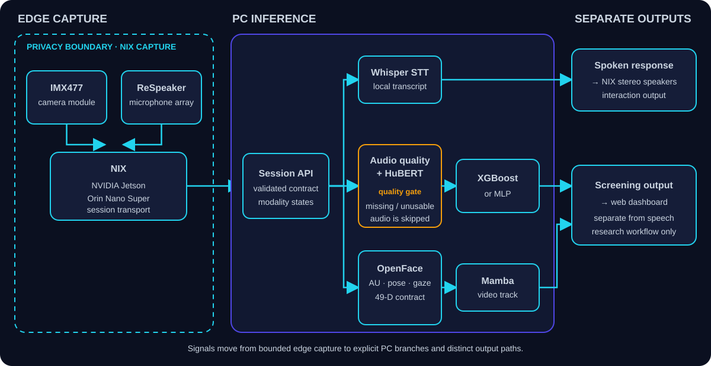
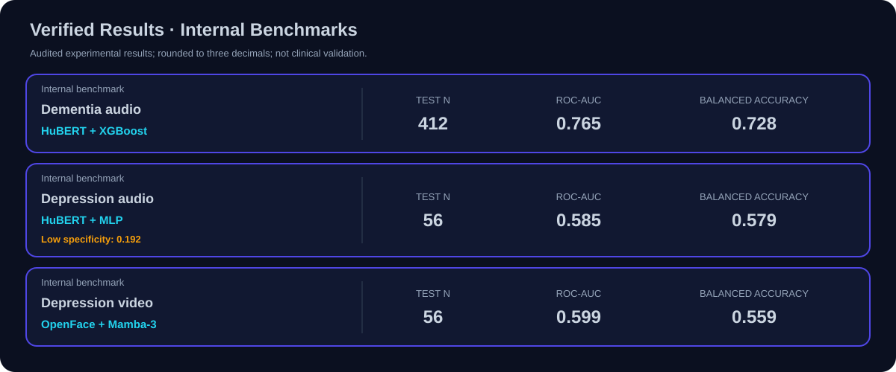

# MindScope

**음성과 영상의 연구 모델을, 기기에서 서버까지 하나의 흐름으로 연결합니다.**

> **Research prototype — not a medical diagnosis.** 아래 수치는 내부 연구 실험의 결과이며 임상 검증이나 진단 성능을 뜻하지 않습니다.

연구 구성: `Python` · `PyTorch` · `FastAPI` · `Jetson` · `Whisper` · `HuBERT` · `OpenFace` · `XGBoost` · `MLP` · `Mamba`

**NIX, a Jetson-based edge device**, connects camera and microphone inputs to PC analysis. 이 저장소는 이 연구 시스템의 구조·실험 결과와 합성 입력으로 동작하는 공개 데모를 담습니다. 연구용 학습 모델과 실제 참가자 자료는 포함하지 않습니다.


<sub>프로젝트 소개용 시각 자료입니다. 실제 참가자의 측정 화면이나 진단 결과가 아닙니다.</sub>

## 한국어 요약

MindScope는 음성·영상 처리와 엣지 기기, PC 추론 API를 연결한 멀티모달 연구 프로토타입입니다. 연구 시스템에서 NIX는 **NVIDIA Jetson Orin Nano Super**, **IMX477 camera module**, **ReSpeaker microphone array**로 신호를 수집합니다. PC는 입력을 처리하고, 기기의 **stereo speakers**로 보낼 음성 응답과 대시보드용 연구 출력을 별도 경로로 구성합니다.

### 무엇을 하나

- **연구 시스템**: Whisper 음성 인식, HuBERT 음성 특징과 XGBoost·MLP, OpenFace 영상 특징과 Mamba 경로를 하나의 세션 구조로 연결했습니다.
- **공개 데모**: 합성 숫자 배열을 받아 음성 품질과 모달리티 존재 여부를 검사하고, 각 분석 경로의 사용 가능 상태를 반환합니다.
- **연구 기록**: 세 실험 경로의 집계 지표와 평가 한계를 공개합니다. 참가자별 원본 자료나 학습 가중치는 배포하지 않습니다.

공개 API는 연구 모델을 실행하거나 스크리닝 점수를 생성하지 않습니다. 입력이 사용 가능해도 모델이 포함되지 않은 경로는 `not_available_in_public_demo`, 누락되거나 품질 기준을 통과하지 못한 경로는 사유와 함께 `skipped`를 반환합니다.

## System Architecture · 시스템 구성



수집 단계와 PC 처리를 세션 계약으로 연결하고, 입력이 들어온 모달리티만 해당 경로로 보냅니다. 음성 상호작용과 연구 분석 결과는 서로 다른 출력입니다. 대시보드는 연구 시스템의 출력 구성요소이며, 대시보드 소스는 이 저장소에 포함하지 않습니다.

현재 공개 코드의 실행 경계는 [시스템 설계](docs/system-design.md), 요청·응답 형식은 [합성 요청](examples/session_request.json)과 [응답 예시](examples/session_response.json)에 있습니다.

## My Role · 맡은 역할

| 구분 | 담당 범위 |
| --- | --- |
| **ML/AI Integration Lead** | 모델 실험·비교, 음성·영상 처리, PC 추론 API, NIX–PC–서비스 연결 |
| 함께 수행 | 제품 디자인 논의와 통합 피드백 |
| 팀원 담당 | 제품 기획, 물리 디자인과 3D 프린팅 |

## Verified Results · 내부 연구 결과



아래는 **내부 벤치마크**이며 값은 소수 셋째 자리로 반올림했습니다. 전체 수치와 임계값, 혼동행렬은 [평가 문서](docs/evaluation.md)와 [집계 CSV](results/verified_metrics.csv)에 있습니다. 공개 데모를 실행한다고 이 모델 지표가 재현되는 것은 아닙니다.

| Scope | Track | Model | Test n | ROC-AUC | Balanced accuracy | F1 | Specificity |
| --- | --- | --- | ---: | ---: | ---: | ---: | ---: |
| Internal benchmark | Dementia audio | HuBERT + XGBoost | n=412 | 0.765 | 0.728 | 0.712 | 0.686 |
| Internal benchmark | Depression audio | HuBERT + MLP | n=56 | 0.585 | 0.579 | 0.725 | 0.192 |
| Internal benchmark | Depression video | OpenFace + Mamba-3 | n=56 | 0.599 | 0.559 | 0.647 | 0.385 |

우울 음성 경로의 특이도는 0.192로 낮습니다. F1이나 재현율만으로 결과를 해석하면 안 됩니다. 개발 데이터 활용 방식, 테스트 지표를 이용한 모델 선택, 작은 표본과 신뢰구간 부재 때문에 이 수치는 탐색적 결과로 보아야 합니다.

## STAR Case Study · 왜 만들었고 무엇을 연결했나

**상황:** 연구 모델, 기기의 신호 수집, 서버 추론과 출력이 나뉘어 있으면 한 세션에서 어떤 입력과 모델이 실제로 사용됐는지 확인하기 어렵습니다.

**과제:** 입력 누락과 모델의 한계를 감추지 않으면서 기기부터 서버까지 이어지는 연구 흐름을 만드는 것이었습니다.

**구현:** 후보 모델을 비교하고 음성·영상 처리 경로를 구성했습니다. 음성 품질과 모달리티 누락 상태를 추가하고, FastAPI의 세션 계약을 통해 NIX 응답 경로와 연구 출력 경로를 연결했습니다.

**결과:** 세 분석 경로를 공통 세션 구조로 다루고, 음성 응답과 대시보드 출력을 구분했습니다. 공개 저장소에서는 이 구조를 설명하되 실제 데이터와 모델 없이 입력 계약·품질 검사만 실행할 수 있게 했습니다.

## Engineering Highlights · 어떻게 만들었나

### 1. 사용할 수 있는 입력인지 먼저 검사합니다

음성 길이와 RMS를 확인하는 품질 검사를 먼저 실행합니다. 품질이 부족하거나 입력이 없을 때는 결과 값을 만들어 채우지 않고 `skipped`와 이유를 반환합니다.

### 2. 모델 부재를 정상적인 상태로 표현합니다

공개 데모의 [`demo_pipeline.py`](src/mindscope/demo_pipeline.py)는 실제 모델 추론 없이 품질·가용성 메타데이터를 만듭니다. [`api.py`](src/mindscope/api.py)는 합성 세션 입력을 검사하고 이 결과를 반환합니다. 파일 업로드·세션 저장·외부 모델 다운로드는 수행하지 않습니다.

### 3. 공개 입력과 연구 자산의 경계를 유지합니다

공개 영상 계약은 OpenFace 형태의 AU·pose·gaze 49차원 벡터를 검사합니다. 다만 과거 추출 자료의 31·49차원 계약 차이는 별도 검증이 필요한 평가 한계로 남아 있습니다. 예제에는 녹음·프레임·전사문·개인정보 대신 합성 숫자만 사용합니다.

## Reproduction · 직접 확인하기

Python 3.11 이상이 필요합니다. 실행 대상은 **합성 입력의 계약과 품질 검사 데모**입니다.

Windows PowerShell:

```powershell
py -3.11 -m venv .venv
.\.venv\Scripts\Activate.ps1
python -m pip install -r requirements.txt
```

macOS·Linux:

```bash
python3.11 -m venv .venv
source .venv/bin/activate
python -m pip install -r requirements.txt
```

로컬 서버를 실행합니다.

```bash
uvicorn mindscope.api:app --app-dir src --host 127.0.0.1 --port 8001
```

별도 macOS·Linux 터미널에서 합성 요청을 보냅니다.

```bash
curl -sS -X POST http://127.0.0.1:8001/analyze/session \
  -H "Content-Type: application/json" \
  --data-binary @examples/session_request.json
```

별도 PowerShell 창에서 저장소 루트 기준으로 합성 요청을 보냅니다.

```powershell
Invoke-RestMethod -Uri "http://127.0.0.1:8001/analyze/session" `
  -Method Post -ContentType "application/json" `
  -InFile "examples/session_request.json"
```

```bash
python -m pytest -q
python -m compileall -q src tests
```

검사는 API·입력 품질·집계 지표·README와 공개 파일 범위를 확인합니다. 연구 모델의 임상 성능을 검증하는 명령은 아닙니다.

| 경로 | 내용 |
| --- | --- |
| `src/` | 합성 입력용 FastAPI 데모 |
| `examples/` | 합성 요청·응답 |
| `results/` | 집계된 내부 연구 지표 |
| `assets/` | 프로젝트·시스템·결과 시각 자료 |
| `docs/` | 시스템 설계, 평가와 윤리·한계 |
| `tests/` | 입력·API·지표·공개 범위·README 검사 |

## Limitations & Ethics · 현재 한계

- 내부 후향적 실험이며 외부·전향적 검증과 신뢰구간이 없습니다.
- 음성 모델의 개발 데이터 재사용과 테스트 점수에 따른 모델 선택은 결과 해석에 편향을 줄 수 있습니다.
- 데이터의 인구집단·수집 환경, 클래스 불균형, 보정 부족과 영상 특징 계약의 불확실성이 일반화를 제한합니다.
- 실제 연구에는 동의, 데이터 최소화, 접근 통제, 암호화, 보관 기한과 독립 검토가 필요합니다.
- 실제 데이터, 학습 파이프라인·가중치와 대시보드 소스는 공개 범위 밖입니다. 공개 데모는 합성 입력만 메모리에서 처리하고 예측 점수를 반환하지 않습니다.

자세한 내용은 [평가 문서](docs/evaluation.md), [윤리와 제한사항](docs/ethics-and-limitations.md)을 참고하세요.

## Team Credits · 제작 참여

작성자는 **ML/AI Integration Lead**로 모델 실험·멀티모달 처리·PC 추론 API와 NIX 연결을 담당하고 제품 디자인에 기여했습니다. 팀원들은 제품 기획과 물리 디자인·3D 프린팅을 담당했습니다.

재사용·재배포 범위는 [NOTICE.md](NOTICE.md)에 명시되어 있습니다.
